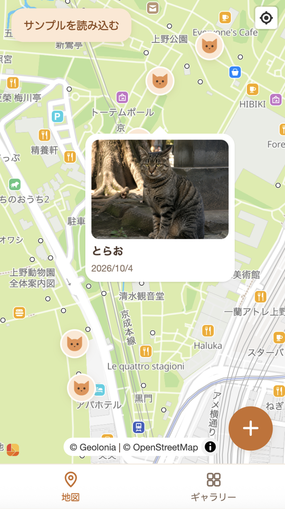
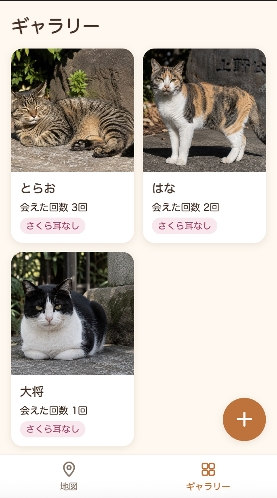
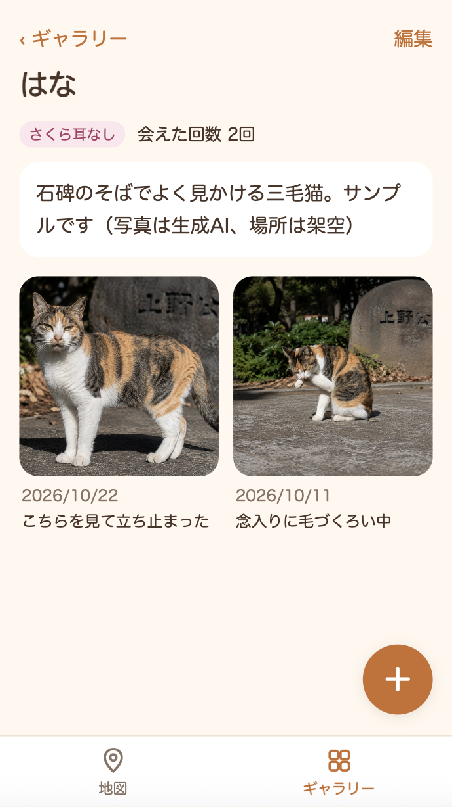

# ねこさんぽ

猫が好きな人向けの、街で出会った猫を記録する地図アプリです。出会った猫が増えていき、自分だけの猫マップができていく、ほっこりした楽しさを目指しました。写真フォルダに埋もれる猫写真とは違い、猫ごと・場所ごとに見返せて、会えた回数や場所がわかります。

**公開ページ：** https://yurigausu.github.io/neko-sanpo/

| 地図 | ギャラリー | 猫の詳細 |
|---|---|---|
|  |  |  |

## 試し方

公開ページを開き、地図かギャラリーの「サンプルを読み込む」を押すと、猫3匹・記録6件が入ります。

サンプルの写真は生成AIで作った画像です。場所は上野公園周辺の架空のデータで、実在の猫の記録ではありません。

## 背景・コンセプト

地域猫を見守りたいと思ったのが、作り始めたきっかけです。将来は地域猫への理解を広め、サポートが必要な猫の把握や子猫の保護につなげたいと考えています。

まずは自分用のアプリとして、自分が楽しく使えることと、ほっこりした見た目を優先しました。

## できること

- **記録の追加：** 端末の写真を選ぶと、撮影日時と位置を読み取ります。位置が読めないときは、現在地を使うか、地図をタップしてピンを置きます
- **地図：** すべての出会いを猫のピンで表示します。ピンをタップすると、猫の名前と写真が出ます
- **ギャラリー：** 猫1匹につきカード1枚で、写真・名前・会えた回数・さくら耳（TNR済みの目印）を表示します
- **猫の詳細：** その猫の写真を新しい順に、日付つきで一覧できます
- **編集と削除：** 猫と記録のメモを編集・削除できます。最後の記録を削除すると、猫も一緒に削除します

iPhoneのSafariとBraveで動作を確認し、写真から位置情報を読み取れることも確かめました。

## 主な利用技術と選定理由

| 技術 | 選定理由 |
|---|---|
| React + TypeScript | 直近で一番触っているため |
| Vite | 普段はwebpackを使っていますが、開発サーバーの起動や更新が速いと聞いて、試してみたかったため |
| HashRouter | GitHub Pagesで画面を再読み込みしても404にならないようにするため |
| IndexedDB（Dexie.js） | サーバーを持たず、写真をブラウザ内に保存するため |
| exifr | 写真から撮影日時と緯度経度を読み取るため |
| MapLibre GL JS | APIキーの有無で、Geolonia MapsとOpenFreeMapを切り替えて使うため |
| GitHub Actions + GitHub Pages | サーバーを持たずに公開し、デプロイを自動化するため |

スマホでの利用を主に想定し、レイアウトはモバイルファーストで作りました。

## セキュリティ上の判断

- **地図のキー：** Geolonia Mapsのキーはコードに含めず、ビルド時にGitHub ActionsのSecretsから渡します。登録したURLでのみ地図を表示できるように制限しています
- **写真と記録：** 写真、位置情報、メモなどの記録はブラウザ内にだけ保存し、サーバーへ送りません
- **地図の表示：** 地図タイルを取得するときに、表示している範囲が地図の配信元（Geolonia MapsまたはOpenFreeMap）に伝わります
- **データの保持：** ブラウザのデータは消えることがあります。消えにくくなるよう `navigator.storage.persist()` を呼んでいますが、保持を保証するものではありません。書き出し機能はまだありません

## 今後の展望

- データのJSON書き出し・読み込み
- PWA化
- 猫ごとの行動範囲をわかりやすく表示する
- ギャラリーの並べ替え・絞り込み
- 出会った回数の多い猫のベスト3を表示するホーム画面
- ネイティブアプリ化
- ログイン・クラウド同期
- ユーザー間の地域猫の情報共有（未去勢の猫の把握、子猫の保護）

情報を公開・共有する場合は、猫の居場所が悪用されないよう、位置をぼかすなどの対策が必要です。

## ローカルでの動かし方

```bash
npm install
npm run dev
```

http://localhost:5173/neko-sanpo/ を開きます。

Geolonia Mapsを使う場合は、`.env.local` にキーを設定します。設定しなければOpenFreeMapで動きます。

```bash
VITE_GEOLONIA_API_KEY=あなたのキー
```
